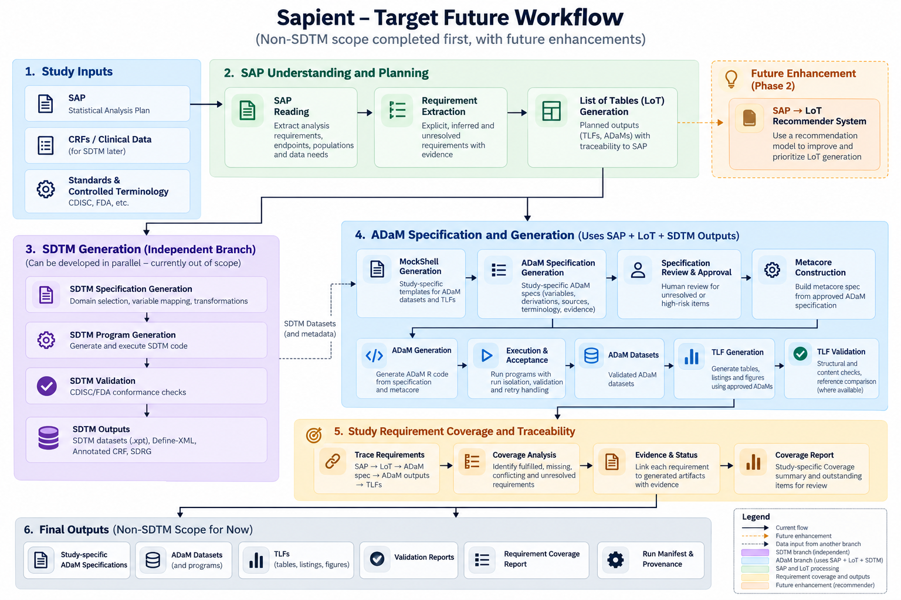

# Sapient

**AI help for clinical statistical programming, built so you can check every step.**

Sapient reads a study's Statistical Analysis Plan (SAP), drafts the ADaM dataset specifications, and writes the R programs that build the datasets, using `admiral` and the pharmaverse packages. It runs every program, checks the output, and stops to ask a person whenever it is unsure.

It is meant for statistical programmers who want to see exactly what AI can and can't do on real clinical work, measured honestly on a public study.

---

## How it fits the work you already do

Sapient doesn't replace the usual process. It speeds up the translation steps and leaves the judgement and sign-off with people.

| Step you know | What Sapient does | Who decides |
|---|---|---|
| Read the SAP | Finds the sections that define populations, baselines, windows and treatment-emergence | – |
| Write the ADaM spec | Drafts it from the SAP plus the ADaM Implementation Guide, then checks that every column it cites exists | **You approve the spec** |
| Program the datasets | Writes the R code one variable at a time, runs it, and fixes its own errors from the exact message | – |
| QC | Compares every value with a reference, cell by cell, and reports what didn't match | **You review the differences** |
| Reuse company standards | Reuses an approved standard program, or edits **a copy** when the study differs | **You sign off anything new** |

## The golden rule: the AI never invents a number

- The AI's only job is to **write R code**. It never produces a clinical value.
- Every number comes from **running that code on the trial data**.
- Settings are fixed and every AI answer is saved, so the same inputs give the same outputs.

## Guardrails: the food inspector in the kitchen

Think of the AI as a fast junior programmer. Around it sit simple, cheap checks that don't use AI:

1. **Real names only.** Dataset, variable and function names must exist in CDISC standards or in the installed R package.
2. **Checked before it runs:** syntax, allowed packages, no hard-coded treatment labels.
3. **Checked after it runs:**
   - Is a date really a date?
   - Are the values in the spec's codelist?
   - Does a value the code compares against actually occur in the data?
4. **Conformance checks**, like Pinnacle 21's: type, length, format and controlled terminology, taken from the spec.
5. **People decide** anything ambiguous or new.

Every run records what each check caught, plus the time and AI usage (`python scripts/run_report.py`). Nothing that fails a check reaches the final dataset.

## The goal



The end goal is the whole path from a study's SAP to its analysis outputs. Every output is traced back to the SAP requirement it satisfies. Everything except SDTM comes first; SDTM is an independent branch for later.

| Stage | The goal | Where we are |
|---|---|---|
| 1. Study inputs | SAP, CDISC standards and controlled terminology; CRFs and raw data later, for SDTM | **Working** on the public CDISC pilot: its SAP, CDISC terminology from NCI-EVS, and ADaM IG rules. |
| 2. SAP understanding | Read the SAP; extract its requirements (explicit, inferred or unresolved, each with the quote it came from); plan the list of tables | **Partly there.** Finding the right SAP sections works. Requirement extraction works on test SAPs, not yet on a real one. Table-list planning is paused: our first way of scoring it was wrong, and the SAP's own table list is now the answer key. |
| 3. SDTM (independent branch) | Write, run and validate SDTM programs | **Not started as AI output.** Hand-written `sdtm.oak` programs exist (98–100% match), but the AI doesn't write them yet. |
| 4. ADaM spec and generation | Mock shells, ADaM spec, human review, metacore, ADaM code, run and accept, then tables, listings and figures (TLFs) | **ADaM works; TLFs don't yet.** Spec drafting, mock shells, code generation one variable at a time, and run-and-accept all work and are measured. TLF programs don't run yet. |
| 5. Coverage and traceability | Trace SAP → table list → spec → ADaM → TLFs; report what's covered, missing or conflicting | **Groundwork only.** Coverage scoring exists and is tested on synthetic SAPs, but isn't connected to the pipeline yet. |
| 6. Final outputs | Specs, ADaM datasets and programs, TLFs, validation reports, a coverage report, a run manifest | **Specs, ADaM datasets and programs, and per-run check and cost reports today.** TLFs, the coverage report and the run manifest are still to come. |

## Results at a glance

These are measured on the public CDISC pilot study and compared with the pilot's own datasets. Full numbers are in [docs/RESULTS.md](docs/RESULTS.md).

- **From the official spec,** the AI's code reproduces **98.6%** of adverse-event (ADAE) values exactly, and 84.0% of the subject-level (ADSL) ones.
- **Specs written by the AI** from the SAP plus ADaM Implementation Guide rules reached **97.7%** on ADAE, with no spec errors left.
- **The hard parts are honest:** lab and time-to-event datasets are much weaker. Where the AI can't find a valid source, it marks the variable **REVIEW** for a person instead of guessing.
- **Cost:** a dataset takes minutes of AI time on a free-tier model.
- **Corrected along the way:** several early numbers turned out to be wrong and were withdrawn. They're listed in the results document with the reasons.

## MCP or code mode?

MCP (Model Context Protocol) is a standard way to plug tools into an AI. "Code mode" gives the AI a small, documented API and lets it write one program that uses it. We tested both on the same job, over four kinds of ADaM dataset:

- **MCP with a few hand-picked tools** works well.
- **MCP with everything plugged in** cost about **30× more** for worse results. The AI re-reads every tool's description on every step.
- **Code mode** is the cheapest, but **only with a carefully designed API.** With our redesigned API it scored 12 of 20 in every run, against 13.7 for MCP with a few tools (3 runs each). It used about a third of the tokens, never got stuck retrying, and never sent patient rows to the AI. With our first API it scored lower and did send patient rows.

Details: [docs/RESULTS.md](docs/RESULTS.md), section 6. The benchmark code is on the `bench/mcp-vs-code-mode` branch.

## What we've learned

1. **The errors live in the spec, not the code.** From the official spec, the AI's code matches 98.6% of ADAE values. When a spec was wrong (made-up age bands, a missing date conversion), the code faithfully reproduced the mistake. So we judge a spec by running the code it produces.
2. **The SAP's value is in the derivations, not the variable names.** Judged on names alone, an AI spec is no better than the standard ADaM IG list. The SAP is what supplies the right age bands, population definitions and treatment-emergent rule.
3. **Rules work better than examples.** Shown a worked example, the model copies it, mistakes included. Given rules it can be checked against (real function signatures, real input columns, the spec's types and codelists), it does better. A wrong rule is worse than no rule.
4. **Running the code is the judge.** A program that runs and passes the checks overrules an AI reviewer that calls it wrong. Three cheap checks after each step took ADSL from 13 to 18 exactly reproduced variables, without making the prompt longer.
5. **Temperature 0 alone doesn't make answers repeatable.** In our benchmark, the same model at temperature 0 gave slightly different answers between runs. Sapient makes runs repeatable by saving every AI answer and replaying it when the same prompt comes back.
6. **How the AI reaches your tools matters as much as which AI it is.** Plugging in every function as a tool cost about 30 times more for worse results. Code mode works, but only on top of a carefully designed API.
7. **Measuring honestly changed our numbers.** Several early figures were wrong and have been withdrawn; [docs/RESULTS.md](docs/RESULTS.md) lists them with the reasons.

## What's next

In order of priority:

1. **January 2027: a beginner-friendly Sapient API and command line.** One install, one study config file, one command per job, and a quickstart on the CDISC pilot. Design: [docs/API_DESIGN.md](docs/API_DESIGN.md).
2. **Any study, not just the pilot.** Today the study set-up (which SDTM domains feed which dataset) is written into the code. It moves into the study config, and each dataset's starting structure will be built from its spec.
3. **One pipeline.** The variable-by-variable code generation that produced the results above is not yet the default path in the end-to-end pipeline.
4. **TLFs that run.** Ground table code on the real arguments of `rtables` and `tern` functions, the same kind of fix that made the ADaM code work.
5. **Requirements on real SAPs, then the coverage report** (stages 2 and 5). Extract requirements from real SAP text and trace each one to the outputs that satisfy it.
6. **Excel specs.** Read specifications in the spreadsheet form most sponsors keep them in.
7. **Replay for everyone.** A rebuild from saved answers already makes zero AI calls (`python scripts/replay_check.py`), but only on a machine that has those answers. Next: publish them, so anyone can replay the results.
8. **Later:** a table-list recommender trained on past studies (Phase 2), and AI-written SDTM programs (stage 3).

If you have a study to test on, get in touch.

---

## Try it

You need:
- Python 3;
- R, with `Rscript` on your PATH;
- a free [NVIDIA Build](https://build.nvidia.com) API key.

```bash
python -m venv .venv && source .venv/bin/activate
pip install -r requirements.txt
printf 'NVIDIA_API_KEY=your_key_here\nHF_TOKEN=your_key_here\n' > .env

# the automated tests: no AI calls, no data needed
python -m unittest discover -s tests

# reuse a company standard program and apply a small study-specific edit to a copy
python scripts/harness_case.py tests/cases/TC-R-006.yaml --apply
```

R packages: `admiral`, `metacore`, `xportr`, `rtables`, `sdtm.oak`, plus `dplyr` and `testthat` for the tests.

**Coming in January 2027:** one install command, one study config file, and one command per job (`sapient spec ADSL`, `sapient build ADAE`), with a five-minute quickstart on the CDISC pilot. Design: [docs/API_DESIGN.md](docs/API_DESIGN.md).

## What lives where

| Folder | What's in it |
|---|---|
| `scripts/` | The tools you run: spec drafting (`gen_spec.py`), code generation (`gen_derivations.py`), scoring and reports |
| `r_layer/` | Everything R: running programs, checks, value comparison |
| `knowledge/` | The reference material that keeps the AI grounded: CDISC terminology, ADaM standards, R function signatures |
| `harness/` | Working inside a company's existing library of standard programs |
| `sponsor_r_env/` | A small make-believe company library used to test that safely |
| `specs/`, `templates/` | Specification handling and program scaffolding |
| `orchestration/` | The end-to-end pipeline that connects the steps |
| `tests/` | The automated tests (117, no internet needed) |
| `docs/` | [Results](docs/RESULTS.md) and the [API design](docs/API_DESIGN.md) |

## Words you'll see

| Term | Meaning |
|---|---|
| **Model / AI model** | The AI that writes the R code (here an open model on NVIDIA's free tier) |
| **Token** | The unit AI usage is counted and billed in, roughly ¾ of a word. Fewer tokens means cheaper and faster. |
| **Prompt** | The text sent to the AI: instructions plus the facts it needs |
| **Temperature 0** | The setting that makes the AI's answers as consistent as possible. On its own it doesn't guarantee the same answer every time. |
| **MCP** | Model Context Protocol: a standard way to connect tools to an AI |
| **Code mode** | Giving the AI an API and letting it write a program, instead of calling tools one at a time |
| **Guardrail** | An automatic check that rejects bad output before it's used |
| **Spec** | The ADaM dataset specification: each variable, its type and how it's derived |
| **IG** | CDISC's ADaM Implementation Guide |
| **Value match** | The share of cells in our dataset that equal the reference dataset's |

## References

- [CDISC CORE](https://www.cdisc.org/core) and the [CDISC Rules Engine](https://github.com/cdisc-org/cdisc-rules-engine): open conformance rules.
- [Pinnacle 21 ADaM validation checks](https://www.pinnacle21.com/blog/how-does-pinnacle-21-implement-adam-validation-checks).
- [Automation in clinical trial statistical programming, a scoping review](https://www.medrxiv.org/content/10.64898/2025.12.24.25342988v2.full): why guardrails matter.
- [Using LLMs to generate clinical trial tables and figures](https://arxiv.org/pdf/2409.12046) (arXiv:2409.12046).
- Data: the pharmaverse packages, the [CDISC SDTM/ADaM pilot project](https://github.com/cdisc-org/sdtm-adam-pilot-project), and CDISC ADaMIG and Controlled Terminology.
